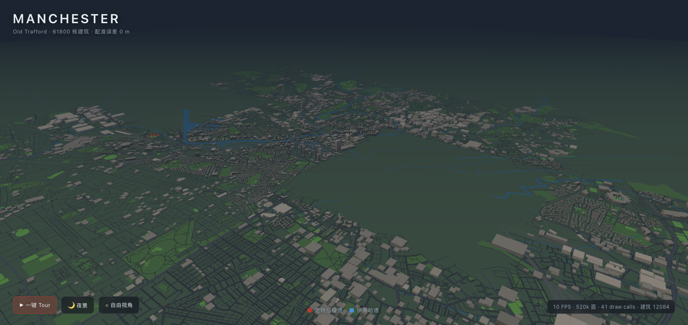

# 曼彻斯特 · 方块城市演示

> 真实地理 + 方块风格。曼彻斯特全城街区与两座球场（老特拉福德 / 伊蒂哈德）按真实坐标，
> 跑在浏览器里。Three.js + 原生 OSM 数据，零外部二进制资产。



## 看什么

| 截图 | 内容 |
|---|---|
| `docs/shot-city.png` | 全城鸟瞰（61 800 栋建筑） |
| `docs/shot-ot.png` | 老特拉福德 · 红色座椅海 |
| `docs/shot-etihad.png` | 伊蒂哈德 · 蓝色座椅海 |
| `docs/shot-night.png` | 夜景窗光 |
| `docs/shot-egg-fireworks.png` | 彩蛋：全城红蓝烟花 |

## 操作

- **鼠标拖拽** 环绕 · **滚轮** 缩放
- **▶ 一键 Tour** 播放 78 秒飞行叙事（运河 → 老特拉福德 → 市中心 → 伊蒂哈德 → 全城）
- **🌙 夜景** 昼夜切换（城市窗光 + 球场灯塔）
- **键入 1999** 金色奖杯升起 · **键入 1000** 全城红蓝烟花 + 双雄传奇墙
- Tour 播放中拖动鼠标即可随时接管相机

## 技术要点

- **数据**：Overpass API 预取（15 分片 + 429 退避重试），构建时简化/量化/投影，
  运行时零网络依赖
- **性能**：三环 LOD（A 环精确挤出 / B 环简化 / C 环丢弃）+ 几何合并，
  全城 **121 448 三角形 / 27 draw calls**（预算 60 万 / 200）
- **地理配准**：局部平面投影（唯一来源 `src/core/geo.js`），两球场距离断言 6 419 m 误差 0.0 m；
  球场朝向三源实测互证（老特拉福德长轴 70.63°，伊蒂哈德 159.9°）
- **程序化球场**：参数化碗形看台 + 座椅海 InstancedMesh + canvas 草坪贴图（含全套白线）
- 零外部二进制资产：建筑、球场、草坪、烟花全部代码生成

## 本地运行

```bash
npm install
npm run pipeline   # 抓 OSM + 构建 city.json（需要网络，只需跑一次）
npm run dev        # http://127.0.0.1:5173/
```

构建：

```bash
npm run build      # 产出 dist/，可直接部署 GitHub Pages
```

## 目录结构

```
manchester-demo/
├── index.html
├── scripts/
│   ├── fetch-osm.mjs          # Overpass 分片抓取 + 重试 + 落盘
│   └── build-city-json.mjs    # 简化 / 量化 / 投影 / 输出 city.json
├── src/
│   ├── main.js                # 装配入口
│   ├── core/                  # geo 投影 / 色板 / 场景灯光 / 昼夜
│   ├── city/                  # 建筑三环 LOD / 道路 / 水系 / 绿地 / 夜景窗光
│   ├── stadiums/              # 参数化碗形生成器 / 老特拉福德 / 伊蒂哈德 / 草坪
│   ├── camera/                # OrbitControls 限位 / Tour 飞行叙事
│   ├── ui/                    # HUD / 样式
│   └── egg/                   # 彩蛋：1999 / 1000
├── docs/
│   ├── WORKLOG.md             # 会话工作日志
│   ├── DECISIONS.md           # 技术决策记录（含数据来源与依据）
│   └── shot-*.png             # 渲染验证截图
└── public/data/city.json      # 构建产物（进 Git）
```

## 署名与合规

- 地图数据 **© OpenStreetMap contributors**（ODbL）
- 看台生成参考 [hszzhua2/stadium-seat-explorer](https://github.com/hszzhua2/stadium-seat-explorer)（MIT）的地理基准数据
- 本项目为**非官方粉丝作品**，与曼联 / 曼城俱乐部无关；不使用任何俱乐部商标资产

## License

MIT
